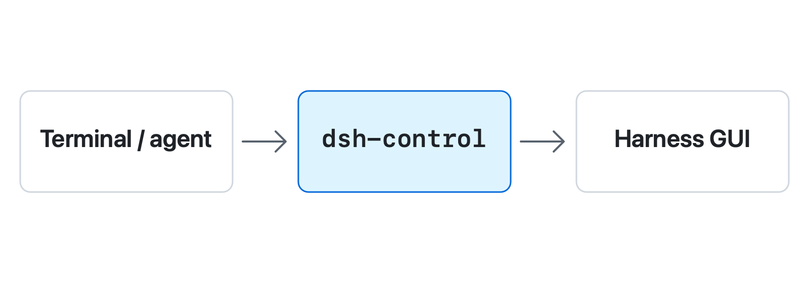

<h1>
<picture>
  <source media="(prefers-color-scheme: dark)" srcset="docs/images/wordmark-dark.png">
  <source media="(prefers-color-scheme: light)" srcset="docs/images/wordmark-light.png">
  
</picture>
</h1>

Control the DeepSeek Harness desktop app from your terminal or coding agent.

- Send prompts, select sessions, and choose models through the GUI.
- Read a specific session and wait for its turn, even when another conversation is visible.
- Get one JSON result per command, with receipts to track submissions and prevent duplicate sends.

<picture>
  <source media="(prefers-color-scheme: dark)" srcset="docs/images/workflow-dark.png">
  <source media="(prefers-color-scheme: light)" srcset="docs/images/workflow-light.png">
  
</picture>

App actions use the Chromium DevTools Protocol (CDP). Session logs and workspace metadata are read only; the tool does not edit Harness storage.

## Requirements

Use macOS 13 or later, Swift 6 to build, and an installed DeepSeek Harness desktop app. The default app location is `/Applications/DeepSeek Harness.app`.

GUI control requires loopback debugging. Debugger access lets local processes control the app; quit and reopen Harness normally when that access is no longer needed, preserving any active work.

For compressed session reads, install Zstandard through Homebrew with `brew install zstd` if needed. Missing library support returns `zstd_unavailable`. Ordinary GUI commands and raw JSONL reads do not require it.

## Install

Build from source:

```sh
git clone https://github.com/AmrMohamad/dsh-control.git
cd dsh-control
swift build -c release
mkdir -p "$HOME/.local/bin"
install -m 755 .build/release/dsh-control "$HOME/.local/bin/dsh-control"
"$HOME/.local/bin/dsh-control" --help
```

The examples below assume `~/.local/bin` is on your PATH. Otherwise, use the full executable path shown above. No shell configuration is changed by these commands.

## First use

Start Harness with GUI control enabled:

```sh
dsh-control start
```

`start` launches a stopped app with loopback debugging, or uses an already-running app with trusted CDP. If Harness is running without debugging, it returns `requires_restart`: save your work, quit normally, and run `start` again.

In Harness, select the conversation you intend to use, then inspect it:

```sh
dsh-control inspect --compact
```

Create a short UTF-8 `brief.md` containing your prompt. With an empty composer, replace `<session-id>` with `result.session.id` and `<expect-token>` with `result.expect` from the inspect JSON output.

Request IDs contain 1–80 ASCII letters, digits, hyphens, or underscores. Use a different ID for each new submission, such as `first-task-001`, and retain it for receipt reconciliation.

```sh
dsh-control send-and-wait --session '<session-id>' --expect '<expect-token>' \
  --request-id first-task-001 --file brief.md --timeout 120
```

Every command prints one JSON object. Exit code `0` means success, `2` means nothing was performed, and `3` means the outcome is uncertain. For an uncertain send, reconcile its receipt instead of resending.

Inspect again if the GUI changes before submission. A verified send confirms that input was accepted; the separate wait outcome tells you whether its turn ended. Read the latest completed answer with:

```sh
dsh-control read --session '<session-id>' --last-assistant --full
```

## Use with an agent

From the repository root, expose the bundled skill in the shared agent directory. This leaves an existing installation untouched:

```sh
mkdir -p "$HOME/.agents/skills"
if [ ! -e "$HOME/.agents/skills/dsh-control" ] && [ ! -L "$HOME/.agents/skills/dsh-control" ]; then
  ln -s "$PWD/skills/dsh-control" "$HOME/.agents/skills/dsh-control"
fi
```

Reload the agent if needed. See [agent setup](skills/dsh-control/references/commands.md#agent-skill-installation) for other locations and the [skill](skills/dsh-control/SKILL.md) for the operating workflow. The agent needs access to this Mac and its executable.

## Limits and troubleshooting

- **Uncertain send:** reconcile the original receipt with `dsh-control receipt --request-id first-task-001 --reconcile`, using your submission's ID. Do not resend with another ID to repair a wait timeout.
- **Long briefs:** `--long-brief reference` passes a local file path; `--long-brief attach` requires verified upload support. See [file handling](skills/dsh-control/references/commands.md#draft-send-and-stop).
- **Workspace picker:** registration needs Accessibility/event-posting permission and a visible interactive desktop. See [workspace requirements](skills/dsh-control/references/commands.md#sessions-workspaces-and-configuration) if selection is refused.
- **Cancellation:** parent cancellation has been verified; full child cancellation remains unverified. Check each returned outcome.
- **Composer unavailable:** inspect `composer.reason` for the observed cause. See [composer guidance](skills/dsh-control/references/commands.md#draft-send-and-stop). App updates may require adapter changes.

## Reference and development

See the [command reference](skills/dsh-control/references/commands.md) for options, JSON input, exit codes, and recovery behavior. Run `swift test` for Swift tests; [development checks](skills/dsh-control/references/commands.md#development-checks) describe optional DOM tests. Report problems through [GitHub issues](https://github.com/AmrMohamad/dsh-control/issues).
